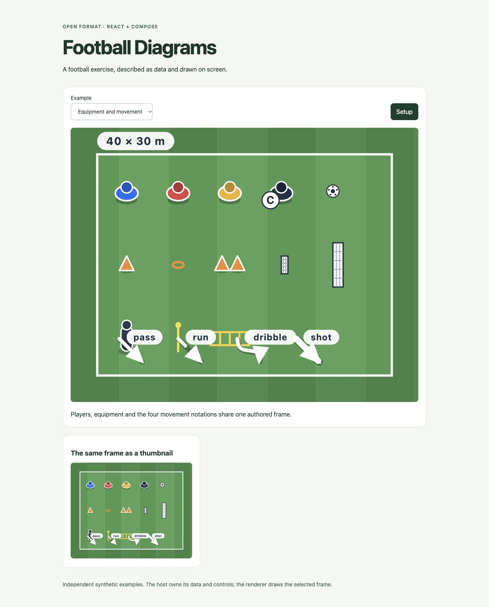
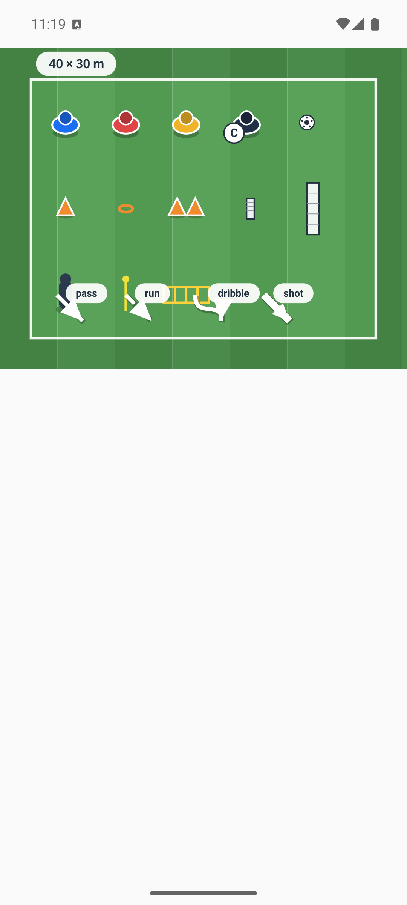
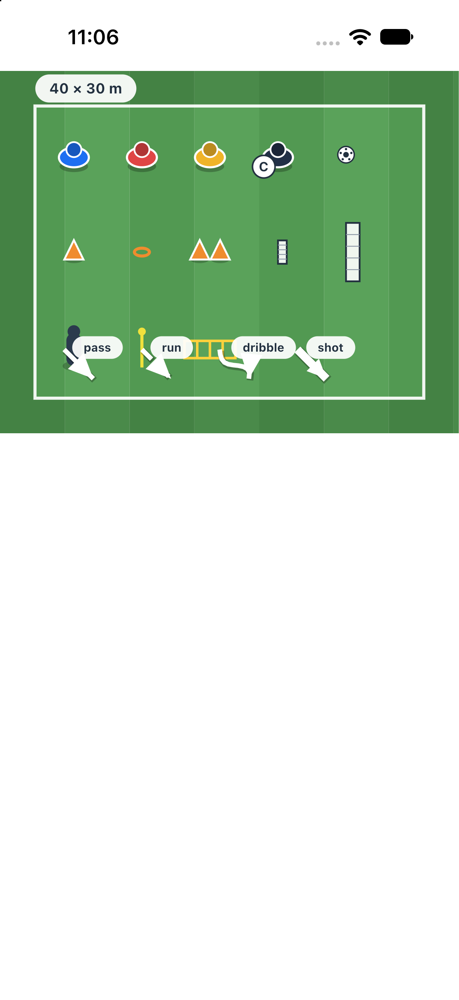

# Football Diagrams

An open JSON format for football diagrams, with React SVG and Kotlin/Compose Canvas renderers.

Describe a rectangular playing area, positioned players and equipment, arrows, labels and frames. Use the same document on a website, Android or iOS. The host supplies its own content, storage and controls.

## See it rendered

The same synthetic [equipment and movement document](fixtures/valid/all-kinds.json) rendered on the web and mobile: 13 player/equipment symbols and four movement notations (`pass`, `run`, `dribble`, `shot`). These are real captures from the independent v0.1.0 examples.

### React SVG



The example supplies the surrounding page, frame controls and thumbnail panel; `DiagramSvg` draws the pitch and its contents.

### Kotlin/Compose Canvas

| Android | iOS |
| --- | --- |
|  |  |

Captured on an Android emulator and iPhone simulator. `FootballDiagram` draws the diagram; the host app owns the screen, safe-area insets and controls. See the runnable [React](examples/react), [Android](examples/android) and [Compose/iOS](examples/compose) examples.

## Source release

The `v0.2.1` distribution is tagged source. JavaScript includes built ESM and TypeScript declarations; Kotlin is a standalone Gradle project. This release does not require a private repository, application backend, account or application stylesheet. npm-registry and Maven Central publication are separate distribution options, not prerequisites for these instructions.

```sh
npm install github:nick-cobra/football-diagrams#v0.2.1 react
```

Applications should resolve and pin the full commit in their lockfile. Review the release and dependency update before changing that pin.

## React

```tsx
import { parseDiagram } from 'football-diagrams';
import { DiagramSvg } from 'football-diagrams/react';

const diagram = parseDiagram({
  format_version: 1,
  title: 'Pass and move',
  area: { shape: 'rectangle', length_m: 30, width_m: 20 },
  frames: [{
    id: 'setup', title: 'Setup',
    objects: [{ kind: 'player', x: 5, y: 10, number: 1 }],
    arrows: [{ kind: 'pass', points: [{ x: 6, y: 10 }, { x: 20, y: 10 }] }],
  }],
});

export function Example() {
  return <DiagramSvg diagram={diagram} frameIndex={0} />;
}
```

`thumbnail` omits shirt/sequence badges and the area label. `className` and `style` belong to the host. Text is rendered as text, with no HTML injection interface. Empty documents and out-of-range frame selections draw nothing. React marker IDs are unique within a shared React root; separate server roots should supply distinct React `identifierPrefix` values.

Treat renderer inputs as snapshots: replace changed areas, frames, arrows and point lists instead of mutating them in place. Both renderers reuse selected-frame arrow geometry and track their measured viewport; Compose retains metre-space arrow Paths and only the most recent viewport and scaled drawing. Host presentation and accessibility updates still apply normally.

Compose bounds its text-layout LRU to twice the active label count, covering original and fitted text. Position-only updates and same-text frame navigation reuse layouts; changing the label count resizes the cache, and older text/size entries are evicted within that bound. In Compose, frame captions and identities do not invalidate painting; titles still update accessibility descriptions. Its arrow text, sequence and badge edits reuse unchanged arrow geometry. Colour and ball-only edits reuse label placement. Small continuous resizes temporarily scale text from a recent reference measurement; after 120 ms without size changes, text is remeasured at the exact size. Drawing-scale jumps below 0.8× or above 1.25× the reference remeasure immediately. Badge/pill containment is preserved during interpolation; settled rendering uses the normal exact metrics.

React fits badge text inside its circle and expands pill backgrounds using actual SVG font metrics. Measurements run together after host commits, viewport/text-bound changes and web-font loading. Server markup uses deterministic estimated boxes until hydration can measure the host font; no browser globals or font cache are shared across server requests.

The SVG defaults to `width="100%"` and derives its natural height from its viewBox. Host CSS (including a supplied class or a parent selector) overrides this presentation attribute; explicit `style` props take normal inline-style precedence. For a fixed-height thumbnail, size both the container and its SVG:

```css
.thumbnail { width: 355px; height: 168px; }
.thumbnail svg { display: block; width: 100%; height: 100%; }
```

For static server-rendered SVGs with a fixed aspect, supply numeric or `px` inline `style.width` and `style.height`. The root declares the SVG namespace so the raw markup can also load as a standalone SVG image. Without explicit dimensions the initial server rendering uses the natural viewBox aspect; client layout observes external CSS and parent resizing after hydration.

In SVG text and document-derived attributes, XML 1.0-forbidden characters (including isolated UTF-16 surrogates) display as U+FFFD replacement characters. Valid Unicode, surrogate pairs and XML-legal whitespace are retained in the markup. Parsing, serialising and rendering preserve the authored string values in the JSON document.

The default SVG `preserveAspectRatio` centres the drawing inside that box without stretching it.

Run the independent example with `npm ci && npm run demo`. The command prints its local URL and does not open a browser.

## Kotlin/Compose

Download the tagged source or check out the exact release commit:

```sh
git clone --branch v0.2.1 --depth 1 https://github.com/nick-cobra/football-diagrams.git
```

Include its independent Gradle project in the consumer's `settings.gradle.kts`:

```kotlin
includeBuild("../football-diagrams/kotlin") {
    dependencySubstitution {
        substitute(module("io.github.nick-cobra:football-diagrams"))
            .using(project(":library"))
    }
}
```

Add `implementation("io.github.nick-cobra:football-diagrams:0.2.1")` to `commonMain`.

```kotlin
import io.github.footballdiagrams.Diagrams
import io.github.footballdiagrams.FootballDiagram

val diagram = Diagrams.parse(jsonText)

@Composable
fun Example() {
    FootballDiagram(diagram = diagram, frameIndex = 0)
}
```

The Kotlin project builds without Node or a JavaScript checkout setup. It targets Android, JVM, iOS device arm64 and iOS Simulator arm64. Initial supported toolchain: JDK 21, Gradle 9.5.1, Kotlin 2.4.20, Compose Multiplatform 1.12.1, Android KMP plugin 9.2.1, Android API 37/minimum 26. Native builds require a compatible installed Xcode. The host owns any Compose theme, safe-area insets, navigation and frame controls. On iOS, embed it in the host's `ComposeUIViewController`; set `CADisableMinimumFrameDurationOnPhone` to `true` in `Info.plist`, as required by Compose on high-refresh-rate iPhones. Modern UIKit hosts must adopt the scene lifecycle.

Independent source examples are in [`examples/android`](examples/android) and [`examples/compose`](examples/compose). From the repository root, run `kotlin/gradlew -p examples/android assembleDebug` for Android, or `kotlin/gradlew -p examples/compose jvmTest linkDebugFrameworkIosSimulatorArm64` for a standalone Kotlin consumer and iOS framework. The Compose example includes a UIKit scene host and its required plist entries; an existing Xcode app can use those with the built framework. Neither project needs Node, an API server or an application account.

## The format

[`schema/diagram.schema.json`](schema/diagram.schema.json) is the immutable format-1 contract; [`schema/diagram-v2.schema.json`](schema/diagram-v2.schema.json) defines format 2. See [FORMAT.md](FORMAT.md) for fields, units, versioning, reader/writer compatibility and rendering limits. TypeScript declarations and JavaScript validators are generated from these schemas; Kotlin embeds and validates the selected schema before decoding its models. Both languages run the same [valid and invalid fixtures](fixtures).

The format contains drawing data. Product taxonomies, subscriptions, permissions, publication records and database identifiers belong to the host application. The library performs no network requests for content or account access.

## Verification

```sh
npm ci
npm test
npm run demo:build
cd kotlin
./gradlew :library:jvmTest :library:testAndroidHostTest
./gradlew :library:compileKotlinIosSimulatorArm64 :library:iosSimulatorArm64Test
```

Native test execution uses the installed simulator tooling. On shared machines, select and exclusively coordinate the intended device through your own device tooling before running simulator tests.

For a cold-consumer check, install the public Git pin in a new directory and use the exported entry points. For Kotlin, include the downloaded tagged project through the documented composite dependency. A sibling development checkout is not release-consumption evidence.

## Updating and rollback

The current source identifies itself as **0.3.0-dev.1**, an unreleased build adding explicit format 2 for authored goal axes and gate widths. Format 1 retains its old geometry. See [the format-2 contract and compatibility matrix](FORMAT.md#format-2-authored-equipment-geometry-unreleased) and [standalone example](fixtures/valid/authored-equipment-v2.json). Integrations must pin a reviewed full source SHA and use Kotlin coordinate `io.github.nick-cobra:football-diagrams:0.3.0-dev.1`; the tagged installation examples above continue to describe released 0.2.1. No development tag or package publication is implied.

Version 0.2.1 retains JSON format 1 and the 0.2.0 Kotlin model API. It adds parser transport limits and bounded renderer detail for extreme inputs/viewports, plus fixes zero-size native drawing. Ordinary diagrams retain their reviewed rendering. See [the release notes](https://github.com/nick-cobra/football-diagrams/releases/tag/v0.2.1) and [FORMAT.md](FORMAT.md) for the resource envelope and rendering detail policy.

Version 0.2.0 retains JSON format 1 and its immutable schema. Kotlin drawing-number model properties now use `Double` instead of `Float` to preserve binary64 values. Rebuild compiled consumers; replace Float constructor arguments with Double values (for example, `DiagramObject(kind, x = 5.0, y = 10.0)`) and convert model values explicitly with `.toFloat()` where a drawing API requires it. `DiagramArea` and `DiagramPoint` retain Float constructor overloads. See [the release notes](https://github.com/nick-cobra/football-diagrams/releases/tag/v0.2.0) for parser and renderer fixes.

Update the exact Git revision and lockfile together, then run the host's parser, document, render and platform tests. Keep TypeScript and Kotlin consumers on the same reviewed source revision. Roll back both the source pin and its lockfile entry to the previous verified commit, then repeat those checks. The public schema's `format_version` is distinct from the package's release version.

Library source is MIT licensed. The Gradle wrapper retains its Apache-2.0 licence; the generated JavaScript validator includes an Ajv MIT helper (see `LICENSES/`). Synthetic examples are included; no external drill catalogue or user data is bundled.

Detailed automatic Android host image checks, explicit native CI execution and the manual UIKit capture procedure are documented in [Compose rendering proof](docs/testing/compose-rendering.md).

Actual packed/installed JS and cold public Git/Gradle consumer checks, their toolchain matrix and retained hash/execution reports are documented in [Installed distribution verification](docs/testing/installed-consumers.md).
